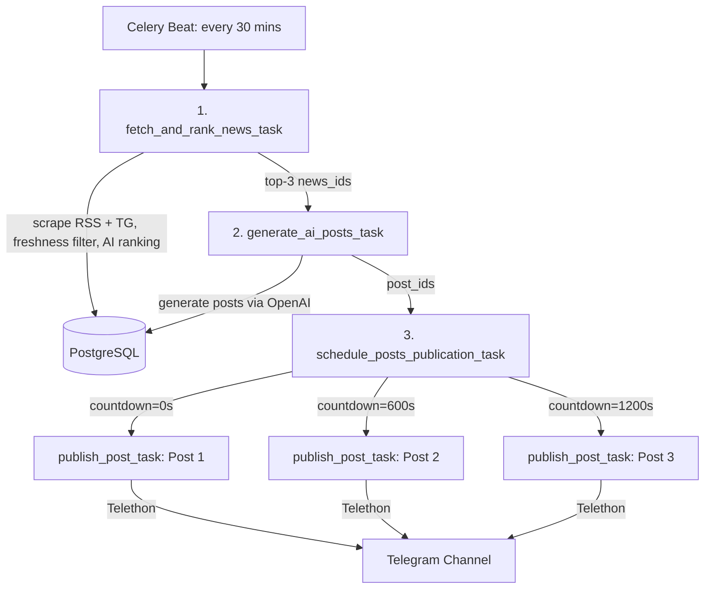

# AI News Telegram Automation Service (aibot)

An automated AI-driven service for managing Telegram news channels. The service aggregates news articles from active website RSS feeds and public Telegram channels, filters and scores candidates using LLM-based AI ranking (OpenAI), generates engaging and concise Telegram posts with emojis and calls to action (CTA), and publishes them on a schedule via Celery, RabbitMQ, and Telethon.

---

## 🛠 Technology Stack

- **Language:** Python 3.14
- **Package Manager:** `uv`
- **Web Framework:** FastAPI, Uvicorn (asynchronous REST API)
- **Database & ORM:** PostgreSQL 16, SQLAlchemy 2.0 (asyncio, asyncpg), Alembic migrations
- **Task Queue & Broker:** Celery 5.4+, RabbitMQ 3 (with Management Web UI)
- **Parsers:** Telethon (Telegram channels), Selectolax, Trafilatura (RSS feeds and websites)
- **AI Modules:** OpenAI API (`gpt-4o-mini` / `gpt-5-nano`)
- **Testing:** pytest, pytest-asyncio (153 tests, 100% pass)

---

## 🚀 Pipeline & Queue Architecture (Celery + RabbitMQ)

The service implements an asynchronous **Celery Chain** workflow coupled with delayed, staggered publications via `apply_async(countdown=...)`:



1. **Celery Beat (`run-news-pipeline-every-30-mins`)**:
   Runs every 30 minutes (`crontab(minute="*/30")`) and triggers the 3-step pipeline:
   - **`fetch_and_rank_news_task`**: Gathers candidates from active RSS feeds and Telegram channels. Filters incoming candidates by publication freshness (`published_at >= cutoff`, configurable via `NEWS_MAX_AGE_HOURS=48`). Evaluates fresh candidate articles using `AINewsRanker` (scoring 1.0–10.0 and generating editorial justification) and saves **all** evaluated articles to the database (with `parsed_at`, `ai_score`, `ai_reason`). If fewer than 10 fresh articles are found, it supplements the candidate pool with up to 10 top-rated unposted articles from the database that are also within the freshness window. Selects the top 3 items for publication and returns `[news_id, ...]`.
   - **`generate_ai_posts_task`**: Receives `news_ids`, invokes `PostGenerator` for each news item, and saves generated posts with status `GENERATED`. Returns `[post_id, ...]`.
   - **`schedule_posts_publication_task`**: Takes `post_ids` and schedules staggered publication tasks spaced 10 minutes apart:
     - Post 1: `countdown=0` (immediate)
     - Post 2: `countdown=600` (after 10 minutes)
     - Post 3: `countdown=1200` (after 20 minutes)

2. **Publishing Task (`publish_post_task(post_id)`):**
   - Calls `TelegramPublisher(session).publish_post(post_id)`.
   - **Atomic Lock:** Executes an atomic database transition `UPDATE posts SET status = 'PUBLISHING' WHERE id = :post_id AND status IN ('NEW', 'GENERATED', 'FAILED') RETURNING *` to eliminate race conditions and prevent concurrent or duplicate publications.
   - Publishes the post to the configured Telegram channel (`TG_TARGET_CHANNEL`) via Telethon.
   - **Error Handling & Retry Policy:**
     - **Transient Errors:** Telegram rate limits (`TelegramPublishFloodWaitError`) or connectivity issues (`TelegramPublishNetworkError`, `ConnectionError`, `OSError`, `TimedOutError`). The post status is reverted to `GENERATED` (it is **not** prematurely marked `FAILED`), and Celery automatically retries with custom countdowns (FloodWait duration or exponential backoff).
     - **Retry Exhaustion:** Only after all retries are exhausted (max 3 retries), the post is marked as `FAILED`.
     - **Permanent Errors:** Missing permissions (`TelegramPublishForbiddenError`), private or invalid channels (`TelegramPublishChannelError`), or unauthorized session (`TelegramPublishUnauthorizedError`) immediately mark the post as `FAILED` without retrying.

---

## ⚙️ Installation & Running

### Option 1: Full Stack via Docker Compose (Recommended)

Launch all 5 services (`PostgreSQL`, `RabbitMQ`, `FastAPI`, `Celery Worker`, `Celery Beat`) with a single command:

```bash
cp .env.example .env
# Configure your API keys in .env (OPENAI_API_KEY, TG_API_ID, TG_API_HASH, TG_TARGET_CHANNEL)
docker compose up --build -d
```

- **Swagger UI Documentation:** [http://localhost:8000/docs](http://localhost:8000/docs)
- **RabbitMQ Management Dashboard:** [http://localhost:15672](http://localhost:15672) (credentials: `guest` / `guest`)
- **View Container Logs:** `docker compose logs -f`
- **Stop Services:** `docker compose down`

---

### Option 2: Local Development Setup

#### 1. Start Infrastructure (PostgreSQL + RabbitMQ)
```bash
docker compose up -d db rabbitmq
```

#### 2. Install Dependencies & Run Database Migrations
```bash
uv sync
uv run alembic upgrade head
```

#### 3. Authorize Telegram Session (One-time setup)
```bash
uv run python scripts/auth_telegram.py
```

#### 4. Start Application Services (in separate terminal windows)
- **FastAPI Web API:**
  ```bash
  uv run uvicorn app.main:app --reload --port 8000
  ```
- **Celery Worker:**
  ```bash
  uv run celery -A celery_worker.celery_app worker -l info -P solo
  ```
  *(Note: `-P solo` is recommended on Windows to support asyncio/Telethon in the worker process).*
- **Celery Beat (Scheduler):**
  ```bash
  uv run celery -A celery_worker.celery_app beat -l info
  ```

---

## 📡 REST API Endpoints

The interactive OpenAPI/Swagger documentation is available at [http://localhost:8000/docs](http://localhost:8000/docs).

| Category | Method | Endpoint | Description |
|---|---|---|---|
| **News** | `GET` | `/api/news` | Retrieve parsed news ordered by `parsed_at` descending (`limit`, `offset`) |
| | `POST` | `/api/news/fetch` | Trigger RSS news scraping and storage |
| | `POST` | `/api/news/fetch/telegram` | Trigger scraping from public Telegram channels |
| **AI Generation** | `POST` | `/api/generate` | Generate post draft on demand for custom text (Spec Item 9) |
| | `POST` | `/api/generate/custom` | Alternative endpoint for custom text post generation |
| | `POST` | `/api/generate/news` | Generate or regenerate post draft from existing DB `news_id` |
| **Posts** | `GET` | `/api/posts` | View generated post history with filters (`status`, `news_id`) |
| | `GET` | `/api/posts/{post_id}` | Retrieve single post details by ID |
| | `POST` | `/api/posts/{post_id}/publish` | Manually publish an individual post to Telegram |
| **Sources** | `GET` | `/api/sources` | List configured news sources (sites and Telegram channels) |
| | `POST` | `/api/sources` | Add a new news source |
| | `PUT` | `/api/sources/{source_id}` | Update source attributes or toggle enabled state |
| | `DELETE` | `/api/sources/{source_id}` | Delete a news source |
| **Filters** | `GET` | `/api/keywords` | List active keyword filters |
| | `POST` | `/api/keywords` | Add a keyword filter |
| | `PUT` | `/api/keywords/{keyword_id}` | Update an existing keyword filter |
| | `DELETE` | `/api/keywords/{keyword_id}` | Remove a keyword filter |
| **System** | `GET` | `/health` | Healthcheck for DB connection and service status |

---

## 📝 API Request Examples (cURL)

### 1. Add RSS Feed Source
```bash
curl -X POST "http://localhost:8000/api/sources" \
     -H "Content-Type: application/json" \
     -d '{
       "name": "Ukrainska Pravda",
       "type": "site",
       "url": "https://www.pravda.com.ua/rss/",
       "enabled": true
     }'
```
*Response (`201 Created`):*
```json
{
  "id": 1,
  "name": "Ukrainska Pravda",
  "type": "site",
  "url": "https://www.pravda.com.ua/rss/",
  "enabled": true
}
```

### 2. Add Telegram Channel Source
```bash
curl -X POST "http://localhost:8000/api/sources" \
     -H "Content-Type: application/json" \
     -d '{
       "name": "Diia Channel",
       "type": "tg",
       "url": "@diia_gov",
       "enabled": true
     }'
```

### 3. Add Keyword Filter
```bash
curl -X POST "http://localhost:8000/api/keywords" \
     -H "Content-Type: application/json" \
     -d '{
       "word": "Artificial Intelligence"
     }'
```

### 4. Manually Trigger RSS Scraping
```bash
curl -X POST "http://localhost:8000/api/news/fetch" \
     -H "Content-Type: application/json" \
     -d '{
       "use_ai_filter": true,
       "top_k": 3
     }'
```
*Response (`200 OK`):*
```json
{
  "sources_checked": 1,
  "sources_failed": 0,
  "total_found": 15,
  "relevant_matched": 15,
  "new_saved": 3,
  "failed_sources": [],
  "message": "Successfully parsed, filtered and saved 3 news items"
}
```

### 5. Generate Post on Demand (`/api/generate`)
```bash
curl -X POST "http://localhost:8000/api/generate" \
     -H "Content-Type: application/json" \
     -d '{
       "title": "Ukraine launches $10M grant fund for AI startups",
       "content": "The Ministry of Digital Transformation announced a dedicated fund to foster deeptech and generative AI innovations.",
       "source_url": "https://example.com/ai-fund"
     }'
```
*Response (`200 OK`):*
```json
{
  "generated_text": "🚀 **Ukraine Launches $10M Grant Fund for AI Startups!**\n\nThe Ministry of Digital Transformation has introduced a major funding initiative supporting domestic deeptech and generative AI innovators.\n\nAre you planning to apply for a grant with your startup?\n\n🔗 Details: https://example.com/ai-fund\n\n#tech #startups #ukraine #ai"
}
```

### 6. Generate Post from Existing News Item
```bash
curl -X POST "http://localhost:8000/api/generate/news" \
     -H "Content-Type: application/json" \
     -d '{
       "news_id": "8a72b8c9d0e1f2...",
       "regenerate": true
     }'
```

### 7. Publish Post to Telegram Channel
```bash
curl -X POST "http://localhost:8000/api/posts/1/publish" \
     -H "Content-Type: application/json" \
     -d '{
       "target_channel": "@my_test_channel"
     }'
```
*Response (`200 OK`):*
```json
{
  "id": 1,
  "news_id": "8a72b8c9d0e1f2...",
  "generated_text": "🚀 **Ukraine Launches $10M Fund...**",
  "published_at": "2026-10-26T14:30:00Z",
  "status": "published"
}
```

---

## 📋 Functionality Checklist (Project M4-1 Spec)

| № | Feature | URL / Command | Methods | Technologies | Implementation Status |
|---|---|---|---|---|:---:|
| 1 | **News Scraping (Websites)** | Celery Beat (`*/30 * * * *`) | - | Celery, Selectolax, Trafilatura | ✅ **Implemented** |
| 2 | **News Scraping (Telegram)** | Celery Beat (`*/30 * * * *`) | - | Telethon, Celery | ✅ **Implemented** |
| 3 | **News Filtering & Selection** | Pipeline / `news_filter.py` | - | Python, Regex, AINewsRanker | ✅ **Implemented** |
| 4 | **AI Post Generation** | Celery Task / `generate_ai_posts_task` | - | OpenAI API, AsyncOpenAI | ✅ **Implemented** |
| 5 | **Publishing to Telegram** | Celery Task / `publish_post_task` | - | Telethon, PostgreSQL atomic lock | ✅ **Implemented** |
| 6 | **Source Management API** | `/api/sources/` | `GET`, `POST`, `PUT`, `DELETE` | FastAPI, SQLAlchemy | ✅ **Implemented** |
| 7 | **Filter Management API (Keywords)**| `/api/keywords/` | `GET`, `POST`, `PUT`, `DELETE` | FastAPI, SQLAlchemy | ✅ **Implemented** |
| 8 | **Post History API** | `/api/posts/`, `/api/posts/{id}` | `GET` | FastAPI, SQLAlchemy | ✅ **Implemented** |
| 9 | **Manual AI Generation** | `/api/generate/`, `/api/generate/custom`, `/api/generate/news` | `POST` | FastAPI, OpenAI | ✅ **Implemented** |
| 10 | **API Documentation (Swagger)**| `/docs`, `/redoc` | `GET` | FastAPI (OpenAPI) | ✅ **Implemented** |
| 11 | **Logging** | Console / Docker logs | - | standard logging | ✅ **Implemented** |

---

## 🧪 Testing

Run the full automated test suite using `pytest`:

```bash
uv run pytest
```

All **153 unit and integration tests** run in an isolated environment using SQLite in-memory with full async support (`sqlite+aiosqlite:///:memory:`).
They cover schema validation, CRUD operations, Celery queue scheduling and chains, transient network error retries, publication locks, deduplication, and AI ranking/generation.
